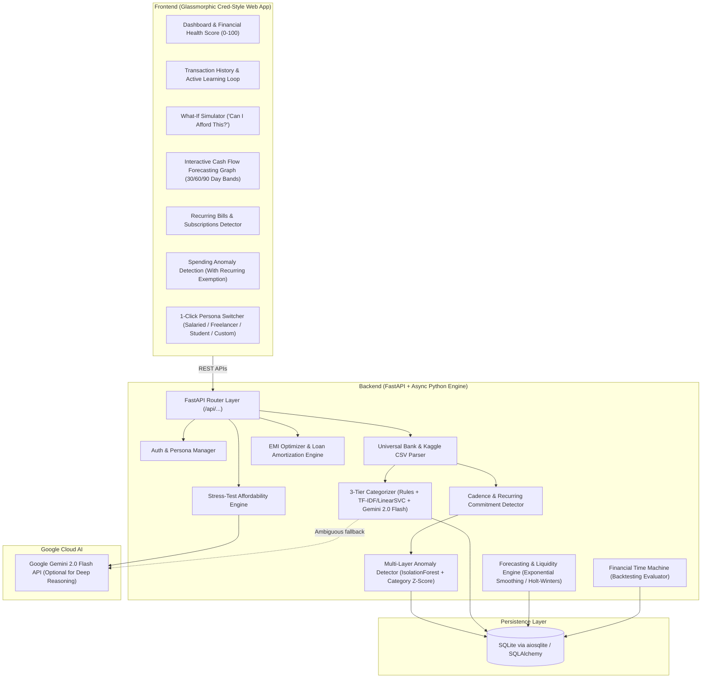

# ClairFinance - Personal Financial Operating System

> **Know if you’ll run out of money, and when, before it happens.**  
> An AI-powered personal financial operating system with automated bank statement ingestion, multi-tier active learning categorization, recurring bill detection, spending anomaly isolation, interactive cash flow forecasting with uncertainty bands, and real-time affordability analysis.

---

## System Architecture



---

## Key Capabilities

1. **Universal Bank & Kaggle CSV Parsing**:
   - Parses diverse Indian bank statements (HDFC, SBI, ICICI, Axis) and international Kaggle datasets (`trans_date_trans_time`, `amt`, `merchant`, `spent`, `cost`, `price`).
   - Supports ISO timestamps, US format (`MM/DD/YYYY`), UK/Indian formats (`DD/MM/YYYY`), Unix epochs, and accounting-style negative numbers.
   - Dedicated custom statement isolation ensures uploaded CSV files replace previous uploads cleanly with zero dummy data contamination.

2. **3-Tier Cascading Categorization with Active Learning**:
   - **Tier 1**: Deterministic regex and prefix rules for high accuracy on common merchants (UPI, Swiggy, Netflix, Bescom, Rent).
   - **Tier 2**: Machine learning classification via `TfidfVectorizer` and `LinearSVC`.
   - **Tier 3**: Google Gemini 2.0 Flash API fallback for ambiguous descriptions.
   - **Active Learning Feedback Loop**: When a user changes a category in the UI, the system dynamically records the correction and retrains the model incrementally.

3. **Multi-Layer Anomaly Detection (With Strict Recurring Exemption)**:
   - Uses Isolation Forest and Category-Specific Z-Scores to flag irregular spending spikes.
   - **Recurring Exemption Rule**: Recurring commitments (e.g. house rent, home loan EMI, SIP investments, society maintenance) are strictly exempted (`anomaly_score = 0.0`) so predictable expenses are never flagged as anomalies.

4. **Interactive Cash Flow Forecast & Time Machine Backtest**:
   - **Interactive Projection Graph**: Features 30, 60, and 90-day horizon switchers, shaded 50% and 90% confidence bands (cyan and purple), and a prominent ₹5,000 Danger Line threshold.
   - **Shortfall Risk Calculator**: Evaluates exact statistical probability of breaching minimum safety buffers.
   - **Financial Time Machine**: Backtests predictions against historical data (Months 1–9 training &rarr; Months 10–12 verification) and displays empirical accuracy percentages and MAPE.

5. **Tools & AI Advisor ("What-If Simulator")**:
   - **What-If Simulator ("Can I Afford This?")**: Evaluates proposed purchases or loan EMIs against projected cash flow, DTI ratio, and emergency buffers using Google Gemini live contextual memory.
   - **EMI Debt Optimizer**: Compares tenure extensions, lump-sum prepayments, and restructuring ROI.
   - **Loan Amortization Calculator**: Generates month-by-month principal and interest repayment schedules with a 12-month summary toggle.
   - **Savings Goal Timeline**: Calculates timeline feasibility and actionable savings accelerators.

6. **1-Click Multi-Persona Switcher**:
   - Pre-seeded with 12 months of realistic Indian financial behavior:
     - 👨‍💼 **Salaried Employee** (Rahul Sharma): Fixed monthly salary (₹75k–₹95k), car EMI, house rent, SIP investments.
     - 👩‍💻 **Freelancer** (Priya Patel): Volatile client payments (₹25k–₹1.2L), SaaS tools (Figma, AWS), feast-or-famine cycles.
     - 🎓 **Student** (Amit Verma): Tight allowance (₹8k–₹12k), UPI micro-transactions, semester fee spikes.
     - 📊 **Custom Statement**: Isolated environment created when uploading your own CSV file.

---

## Quick Start (One Command)

### On macOS / Linux:
```bash
./run.sh
```

### On Windows:
Double-click `run.bat` or run in Command Prompt / PowerShell:
```cmd
run.bat
```

The startup script automatically:
1. Detects Python 3 (3.10+).
2. Creates and configures the virtual environment (`backend/venv`).
3. Installs all required packages from `backend/requirements.txt`.
4. Copies `backend/.env.example` to `backend/.env` if not already present.
5. Generates synthetic 12-month statement datasets for all personas if missing.
6. Pre-seeds the SQLite database with 18 standard categories and persona accounts.
7. Boots the **FastAPI backend** on port 8000 (`http://localhost:8000`).
8. Boots the **Frontend web server** on port 3000 (`http://localhost:3000`).
9. **Automatically launches your web browser** to `http://localhost:3000`.
10. Provides clean, one-key shutdown (`Ctrl+C` on macOS/Linux or pressing any key on Windows).

---

## Environment Configuration & Google Gemini API Key

ClairFinance comes with an example environment configuration at `backend/.env.example`.

To configure your environment:
1. Create a `.env` file in the `backend/` directory (automatically created on first run from `.env.example`):
   ```bash
   cp backend/.env.example backend/.env
   ```
2. Open `backend/.env` and add your Google Gemini API Key:
   ```env
   # Google Gemini API Key (obtain from https://aistudio.google.com/apikey)
   GEMINI_API_KEY="your-gemini-api-key-here"
   ```

> [!NOTE]
> **Does ClairFinance work without a Gemini API Key?**  
> **Yes!** The entire platform runs 100% locally and offline out-of-the-box. When no API key is provided, ClairFinance automatically uses its local rule engines, scikit-learn TF-IDF + LinearSVC classifier, Isolation Forest anomaly models, and statistical cash flow calculators.  
> Supplying a Gemini API key activates enhanced Google Gemini 2.0 Flash reasoning for natural language affordability inquiries, contextual advice, and batch fallback classification.

---

## Manual Installation & Step-by-Step Build

If you prefer to run services manually instead of using `run.sh` / `run.bat`:

### 1. Clone & Set Up Virtual Environment

**macOS / Linux:**
```bash
git clone https://github.com/notalwaysadream/clairfinance.git
cd clairfinance
python3 -m venv backend/venv
source backend/venv/bin/activate
pip install --upgrade pip
pip install -r backend/requirements.txt
```

**Windows (Command Prompt):**
```cmd
git clone https://github.com/notalwaysadream/clairfinance.git
cd clairfinance
python -m venv backend\venv
backend\venv\Scripts\activate.bat
python -m pip install --upgrade pip
pip install -r backend\requirements.txt
```

### 2. Generate Demo Datasets & Seed Database
```bash
python scripts/generate_test_data.py --persona all --output-dir data

python -c "
import asyncio
from app.database import AsyncSessionLocal, engine, Base
from app.routers.personas import seed_all_personas

async def init():
    async with engine.begin() as conn:
        await conn.run_sync(Base.metadata.create_all)
    async with AsyncSessionLocal() as session:
        await seed_all_personas(session)

asyncio.run(init())
"
```

### 3. Start Backend & Frontend

**Terminal 1 (Backend):**
```bash
cd backend
uvicorn app.main:app --host 0.0.0.0 --port 8000 --reload
```

**Terminal 2 (Frontend):**
```bash
cd frontend
python3 -m http.server 3000
```
Open [http://localhost:3000](http://localhost:3000) in your browser.

---

## Repository Structure

```
clairfinance/
├── backend/                        # FastAPI Backend
│   ├── app/
│   │   ├── models/                 # SQLAlchemy ORM models (User, Transaction, Alert, etc.)
│   │   ├── routers/                # API endpoints (transactions, forecast, query, personas)
│   │   ├── schemas/                # Pydantic request & response schemas
│   │   ├── services/               # Parsing, categorization, forecasting, anomaly detection
│   │   ├── utils/                  # Auth, JWT, and persona helpers
│   │   ├── config.py               # Application settings
│   │   ├── database.py             # SQLite async session engine
│   │   └── main.py                 # FastAPI application and static mount
│   ├── tests/                      # Automated test suite
│   ├── requirements.txt            # Python dependencies (cross-platform)
│   └── .env.example                # Example environment variables
│
├── frontend/                       # Interactive Frontend
│   ├── app.js                      # Single-page application logic and API bindings
│   ├── index.html                  # Glassmorphic Cred-style responsive layout
│   └── styles.css                  # Custom styling, dark/light themes, chart animations
│
├── scripts/
│   └── generate_test_data.py       # 12-month synthetic transaction generator
├── data/                           # Persona statement CSVs
├── run.sh                          # One-command startup script (macOS / Linux)
├── run.bat                         # One-command startup script (Windows)
└── README.md
```

---

## API Overview

Access interactive Swagger documentation at [http://localhost:8000/docs](http://localhost:8000/docs) when the backend is running.

| Method | Endpoint | Description |
|---|---|---|
| `GET` | `/api/health` | Service health status check |
| `GET` | `/api/personas` | List available personas (Salaried, Freelancer, Student, Custom) |
| `POST` | `/api/personas/switch/{persona_id}` | Switch active persona and load 12-month dataset |
| `POST` | `/api/transactions/upload` | Ingest bank or Kaggle CSV statement with auto-categorization |
| `GET` | `/api/transactions` | Paginated transaction history with filters and search |
| `PATCH` | `/api/transactions/{id}/category` | Active learning category update and incremental retraining |
| `GET` | `/api/anomalies` | Detected spending anomalies (exempting recurring commitments) |
| `GET` | `/api/forecast/cashflow` | Forward cash flow predictions with 80% confidence intervals |
| `GET` | `/api/forecast/liquidity` | Cash crunch stress test and days until potential shortfall |
| `GET` | `/api/forecast/accuracy` | Financial Time Machine historical backtest evaluation |
| `POST` | `/api/query/ask` | What-If Simulator: "Can I Afford This?" decision query |
| `POST` | `/api/simulator/loan` | Month-by-month loan amortization schedule |
| `POST` | `/api/simulator/emi-optimizer` | Debt restructuring, lump-sum prepayment ROI, and DTI analysis |
| `POST` | `/api/simulator/savings-goal` | Target savings goal timeline and accelerators |

---

## Running Automated Tests

To execute the test suite:

```bash
cd backend
PYTHONPATH=. ./venv/bin/pytest tests/test_api.py -v
```

All 9 integration and endpoint test suites will verify health checks, persona switching, categorization, forecasting, affordability queries, simulators, anomalies, and active learning feedback loops.
