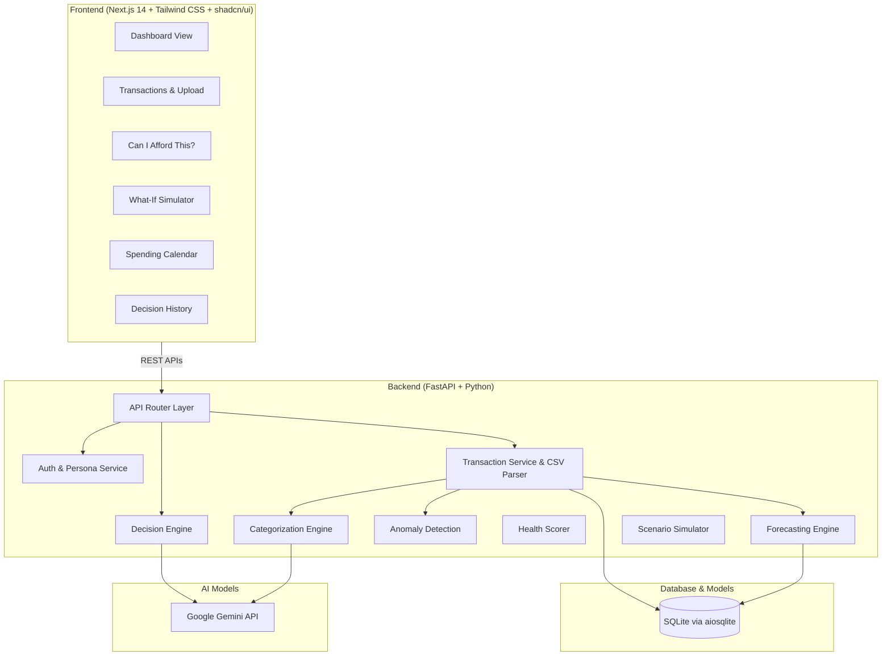

# ClairFinance - Personal Financial Management Platform

A personal financial operating system that parses bank transactions, categorizes expenses, tracks recurring bills, detects anomalies, forecasts cash flow, and answers affordability questions ("Can I afford this?").

---

## Key Features

- CSV Ingestion: Parses bank statements across common Indian bank formats (HDFC, SBI, ICICI, etc.).
- Multi-Tier Categorization: Rule-based keyword matching with scikit-learn ML fallback and Gemini support.
- Cash Flow Forecasting: Predicts future cash flow with upper and lower confidence intervals.
- Anomaly Detection: Flags unusual transactions using category-specific Z-scores.
- Recurring Detection: Identifies subscriptions, EMIs, and bills using interval clustering.
- Financial Health Score: 0-100 score based on savings rate, expense consistency, debt-to-income, emergency buffer, and spending diversity.
- Affordability Query Engine: Answers whether a purchase or loan is affordable based on income, ongoing EMIs, and savings buffer.
- Financial Simulators: Loan amortization, large purchase buffer impact, and savings goal timelines.
- Multi-Persona Support: Built-in datasets for salaried, freelancer, and student profiles.

---

## System Architecture



---

## Repository Structure

```
clairfinance/
├── frontend/                       # Next.js 14 frontend
│   ├── src/
│   │   ├── app/                    # Pages, layouts, routing
│   │   ├── components/             # UI components
│   │   ├── lib/                    # API client and utilities
│   │   └── types/                  # TypeScript interfaces
│   └── public/                     # Static assets
│
├── backend/                        # FastAPI backend
│   ├── app/
│   │   ├── models/                 # SQLAlchemy ORM models
│   │   ├── routers/                # API endpoints
│   │   ├── schemas/                # Pydantic schemas
│   │   ├── services/               # Parsing, categorization, health scoring, forecasting
│   │   ├── utils/                  # Auth and helper utilities
│   │   ├── config.py               # Settings and configuration
│   │   ├── database.py             # Database session management
│   │   └── main.py                 # FastAPI application setup
│   ├── requirements.txt            # Python dependencies
│   └── .env.example
│
├── scripts/                        # Data scripts
│   ├── generate_test_data.py       # Generates test persona CSV files
│   └── seed_db.py                  # Database seeder
│
├── data/                           # Generated test CSVs
├── run_backend.sh                  # One-command backend startup script
├── backend-progress.md             # Implementation tracking
└── README.md
```

---

## Getting Started

### 1. Running the Backend

The fastest way to start the backend is using the startup script:

```bash
./run_backend.sh
```

This script will:
- Check for Python 3.
- Set up the virtual environment (`backend/venv`) and install dependencies if needed.
- Generate the test persona CSV datasets in `data/` if missing.
- Start the Uvicorn server on port 8000.

Interactive Swagger docs will be available at:
http://localhost:8000/docs

### 2. Manual Backend Setup

If you prefer running commands manually:

```bash
cd backend
python3 -m venv venv
source venv/bin/activate
pip install -r requirements.txt
cp .env.example .env
uvicorn app.main:app --reload --port 8000
```

### 3. Test Data Generation

To generate new datasets for any of the 3 personas:

```bash
python scripts/generate_test_data.py --persona all --months 12 --output-dir ./data/
```

To seed a specific CSV into the database:

```bash
python scripts/seed_db.py ./data/salaried_transactions.csv
```

---

## API Summary

- Personas:
  - `GET /api/personas`: list personas
  - `POST /api/personas/switch/{persona_id}`: switch between salaried, freelancer, and student
- Transactions:
  - `POST /api/transactions/upload`: upload bank statement CSV
  - `GET /api/transactions`: list transactions with search and filters
  - `GET /api/transactions/summary`: total income, expenses, and savings rate
- Dashboard:
  - `GET /api/dashboard/overview`: aggregated summary metrics
  - `GET /api/dashboard/cashflow`: monthly cash flow breakdown
  - `GET /api/dashboard/spending-breakdown`: category spending breakdown
  - `GET /api/dashboard/health-score`: 0-100 financial health score
- Decision Engine:
  - `POST /api/query/ask`: affordability evaluation
  - `POST /api/simulator/loan`: loan amortization calculation
  - `POST /api/simulator/purchase`: purchase impact analysis
- Forecast & Alerts:
  - `GET /api/forecast/cashflow`: forward cash flow prediction
  - `GET /api/alerts`: list user alerts
