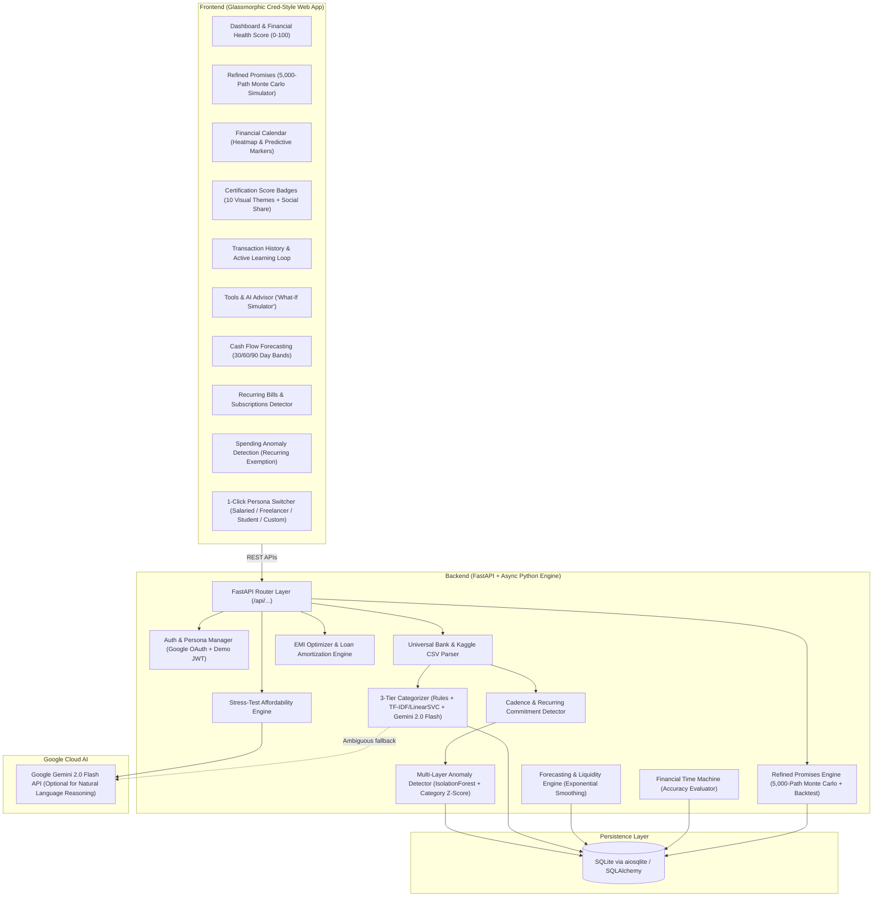

# Clairfinance - Personal Financial Operating System

[](https://clairefinance.onrender.com)
[](https://fastapi.tiangolo.com/)
[](https://www.sqlite.org/)
[](https://aistudio.google.com/)

> **Know if you’ll run out of money, and when, before it happens.**  
> An AI-powered personal financial operating system featuring automated bank statement ingestion, active learning categorization, spending anomaly isolation, interactive cash flow forecasting, financial health scoring with verifiable certification badges, an interactive financial calendar, and **Refined Promises**—a 5,000-path Monte Carlo cash-flow simulation engine with certified empirical backtesting.

🌐 **Live Deployed Application:** [https://clairefinance.onrender.com](https://clairefinance.onrender.com)

---

## System Architecture



---

## Key Capabilities & New Features

### 1. Refined Promises: 5,000-Path Monte Carlo Cash-Flow Simulator
Accessible directly from the prominent banner on the Home dashboard (`#/promises`). Designed to deliver mathematical, empirically verified financial guarantees instead of vague estimates:
* **The Core Simulation Engine**:
  * **Categorization & Flow Decomposition**: Partitions future cash flows into (1) **scheduled items** (recurring salary and commitments with $\pm 1\text{--}3$ days timing jitter), (2) **variable discretionary spending** bootstrapped from user history with day-of-week and payday-proximity weighting, and (3) **irregular income** (freelancer milestone disbursements with arrival-rate distributions).
  * Runs **5,000 simultaneous 30-day Monte Carlo paths** using a fixed random seed for monotonic, rock-solid consistency across queries.
* **Promise 1 ("You could absorb about ₹X [₹L – ₹H] shock tomorrow")**:
  * Employs binary search to determine the maximum shock $S$ such that $\text{shortfall\_prob}(\text{paths}, \text{shock}=S) \le 5\%$.
  * Refits model on bootstrap resamples to establish verified 10th–90th percentile confidence ranges $[L, H]$, dynamically accounting for historical data length.
* **Promise 2 ("This bill raises risk from A% to B%...")**:
  * Evaluates baseline risk $A\%$ versus projected bill risk $B\%$.
  * Identifies the **earliest shortfall date** (the earliest day where cumulative shortfall probability exceeds 50%, or median day among shorted paths).
  * **Greedy Action Plan Solver**: Searches across 4 real-world interventions:
    1. Scaling discretionary spending down by 20%.
    2. Pausing non-essential subscriptions.
    3. Shifting or splitting the bill payment date.
    4. Transferring emergency buffer reserves.
  * Calculates **"Start by [date]" urgency**: reruns plans with incrementally delayed start dates to define the exact deadline before risk exceeds target.
  * **Conservative Upside Modeling**: Unconfirmed client invoices and insurance reimbursements are kept out of the conservative baseline, but reported as an upside note ("would cut risk to ~D% if received on time").
* **Credibility via Rolling Backtests & Calibration Curves**:
  * Executes a rolling historical backtest over 10+ past dates using strictly the data available up to each date.
  * Evaluates empirical hit rates (testing whether $\le 5\%$ predicted risk actually held true $\le 5\%$ of the time).
  * Plots an interactive **Predicted vs. Actual Risk Calibration Curve** alongside Brier calibration error scores to prove promises are statistically conservative.

---

### 2. Financial Calendar (`#/calendar`)
Seamlessly accessible from the Forecast & Backtest view:
* **Monthly Spending Heatmap**: Interactive calendar grid color-coded by daily net spending intensity.
* **Predictive Forward Cash Indicators**: Shows expected bill dates and forward cash-flow safety statuses.
* **Financial Mood & Notes Tracking**: Record daily financial sentiments and view historical expenditure trends by day.

---

### 3. Finance Score Badges & Social Sharing (`#/badge`)
Accessible directly from the Finance Score page:
* **10 Luxury Visual Themes**: Neo-Tokyo, Dark Obsidian, Emerald FinOps, Sunset Rose, Cyberpunk 2077, Royal Gold, Minimal White, Glassmorphic Aurora, Midnight Blue, and Lavender Mist.
* **High-Resolution 1200×750 PNG Export**: Client-side HTML5 Canvas rendering of verified FinOps certification badges.
* **1-Click Social Sharing**: Instant integration with LinkedIn and Instagram sharing with pre-crafted captions and clipboard copy.

---

### 4. Universal Bank & Kaggle CSV Parsing
* Robust ingestion of major Indian bank exports (HDFC, SBI, ICICI, Axis) and international Kaggle formats (`laramee26openBankTransactionData.csv`, `bank-transactions-1000.csv`).
* Auto-detects dates (`YYYY-MM-DD`, `DD/MM/YYYY`, `MM/DD/YYYY`, Unix timestamps), description patterns, and signed or Debit/Credit columns.
* Full isolation between custom statement uploads and pre-seeded demo accounts.

---

### 5. 3-Tier Cascading Categorization with Active Learning
* **Tier 1 (Deterministic)**: Regex and merchant pattern rules for instant zero-latency categorization.
* **Tier 2 (Machine Learning)**: TF-IDF vectorization paired with a `LinearSVC` classifier trained on historical banking data.
* **Tier 3 (AI LLM)**: Google Gemini 2.0 Flash fallback for ambiguous or obfuscated transaction strings (e.g., `UPI-SWIGGY-8823`).
* **Active Learning Feedback Loop**: User category overrides in the UI trigger real-time incremental model retraining.

---

### 6. Spending Anomaly Isolation (With Recurring Exemption)
* Employs scikit-learn `IsolationForest` combined with category-specific Z-scores to flag abnormal spending behavior.
* **Strict Recurring Exemption**: Predictable recurring commitments (rent, loan EMIs, SIP investments, utilities) are automatically exempted (`anomaly_score = 0.0`) to eliminate false positives.

---

### 7. Interactive Cash Flow Forecasting & Financial Time Machine
* Animated SVG trajectory graphs with 30, 60, and 90-day projection horizons.
* Shaded 50% and 90% confidence bands derived from historical variance and seasonality.
* **Financial Time Machine**: Backtests predictions against historical data (Months 1–9 training $\to$ Months 10–12 testing) and reports empirical accuracy and MAPE.

---

### 8. Tools & AI Advisor ("What-If Simulator")
* **"Can I Afford This?"**: Context-aware purchasing simulator utilizing live Gemini memory, cash flow projections, and debt-to-income (DTI) metrics.
* **EMI Debt Optimizer**: Compares tenure extensions, lump-sum prepayments, and restructuring ROI.
* **Loan Amortization Calculator**: Generates monthly principal and interest repayment schedules with a 12-month summary toggle.
* **Savings Goal Timeline**: Calculates target savings feasibility and actionable accelerators.

---

### 9. 1-Click Multi-Persona Switcher
* Pre-seeded with 12 months of authentic Indian financial behavior:
  * 👨‍💼 **Salaried Employee** (Rahul Sharma): Fixed monthly salary (₹75k–₹95k), car loan EMI, house rent, SIP investments.
  * 👩‍💻 **Freelancer** (Priya Patel): Volatile client payments (₹25k–₹1.2L), SaaS subscriptions (Figma, AWS), feast-or-famine cycles.
  * 🎓 **Student** (Amit Verma): Tight monthly allowance (₹8k–₹12k), UPI micro-transactions, semester fee spikes.
  * 📊 **Custom Statement**: Clean, isolated environment for your own uploaded CSV statements.

---

## Live Deployment (Render.com)

The application is deployed live at:
👉 **[https://clairefinance.onrender.com](https://clairefinance.onrender.com)**

### Deploying Your Own Instance on Render

1. Fork or push this repository to GitHub: `https://github.com/notalwaysadream/clairfinance`.
2. Log in to [Render.com](https://render.com) and click **New +** $\to$ **Blueprint**.
3. Connect your repository. Render will automatically read the bundled [`render.yaml`](file:///Users/vsv/Desktop/Projects/clairfinance/render.yaml) blueprint:
   * **Build Command**: `pip install --upgrade pip && pip install -r backend/requirements.txt`
   * **Start Command**: `uvicorn backend.app.main:app --host 0.0.0.0 --port $PORT`
4. Set your environment variables in the Render Dashboard (under **Environment**):
   * `PROJECT_NAME`: `Clairfinance API`
   * `JWT_SECRET_KEY`: *(Any secure random 32-character string)*
   * `GOOGLE_CLIENT_ID`: *(Optional: Your Google OAuth Web Client ID)*
   * `GEMINI_API_KEY`: *(Optional: Your Google Gemini API Key)*
5. Click **Apply**. Render will build and deploy the entire application with backend APIs and frontend static assets served unified on port 8000/10000.

---

## Quick Start (One Command Local Setup)

### On macOS / Linux:
```bash
./run.sh
```

### On Windows:
Double-click `run.bat` or execute in Command Prompt / PowerShell:
```cmd
run.bat
```

The startup script automatically:
1. Detects Python 3 (3.10+).
2. Sets up the Python virtual environment (`backend/venv`).
3. Installs dependencies from `backend/requirements.txt`.
4. Pre-seeds SQLite database with default categories and demo personas.
5. Boots the **FastAPI backend** on port 8000 (`http://localhost:8000`).
6. Boots the **Frontend web server** on port 3000 (`http://localhost:3000`).
7. Opens your browser automatically to `http://localhost:3000`.

---

## Environment Configuration

Clairfinance comes pre-configured to run 100% locally and offline out-of-the-box. An example environment configuration is provided at `backend/.env.example`.

```env
# Clairfinance Environment Variables
PROJECT_NAME="Clairfinance API"
API_V1_STR="/api"

# Database
DATABASE_URL="sqlite+aiosqlite:///./finops.db"
SYNC_DATABASE_URL="sqlite:///./finops.db"

# JWT & Security
JWT_SECRET_KEY="hackathon-secret-jwt-key-2026-super-secure"
GOOGLE_CLIENT_ID=""

# Google Gemini API Key (optional, from https://aistudio.google.com/apikey)
GEMINI_API_KEY=""

# CORS
CORS_ORIGINS=["http://localhost:3000","http://127.0.0.1:3000"]
```

> [!NOTE]
> **Does Clairfinance work without a Gemini API Key?**  
> **Yes!** The entire platform runs offline with deterministic rule engines, scikit-learn TF-IDF + LinearSVC classifiers, Isolation Forest anomaly models, and statistical Monte Carlo cash flow calculators. Supplying a Gemini API key unlocks enhanced natural language reasoning for the AI Advisor.

---

## Manual Installation & Step-by-Step Build

If you prefer to run services manually:

### 1. Clone & Set Up Virtual Environment

**macOS / Linux:**
```bash
git clone https://github.com/notalwaysadream/clairfinance.git
cd clairfinance
python3 -m venv backend/venv
source backend/venv/bin/activate
pip install --upgrade pip
pip install -r backend/requirements.txt
```

**Windows:**
```cmd
git clone https://github.com/notalwaysadream/clairfinance.git
cd clairfinance
python -m venv backend\venv
backend\venv\Scripts\activate.bat
python -m pip install --upgrade pip
pip install -r backend\requirements.txt
```

### 2. Generate Demo Datasets & Seed Database
```bash
python scripts/generate_test_data.py --persona all --output-dir data
python scripts/init_db.py
```

### 3. Start Backend & Frontend

**Terminal 1 (Backend):**
```bash
cd backend
uvicorn app.main:app --host 0.0.0.0 --port 8000 --reload
```

**Terminal 2 (Frontend):**
```bash
cd frontend
python3 -m http.server 3000
```
Open [http://localhost:3000](http://localhost:3000) in your browser.

---

## Repository Structure

```
clairfinance/
├── backend/                        # FastAPI Backend
│   ├── app/
│   │   ├── models/                 # SQLAlchemy ORM models (User, Transaction, Alert, etc.)
│   │   ├── routers/                # API endpoints (transactions, forecast, query, personas, promises)
│   │   │   ├── promises.py         # Refined Promises API router (/api/promises)
│   │   │   ├── forecast.py         # Forecasting and liquidity endpoints
│   │   │   ├── personas.py         # Persona switching and seeding
│   │   │   └── transactions.py     # Statement upload, active learning, categorization
│   │   ├── schemas/                # Pydantic request & response schemas
│   │   ├── services/               # Engines: promises_engine, categorization, forecasting, anomaly
│   │   │   └── promises_engine.py  # 5,000-path Monte Carlo cash-flow & backtest engine
│   │   ├── utils/                  # Auth, JWT, and persona helpers
│   │   ├── config.py               # Application settings
│   │   ├── database.py             # SQLite async session engine
│   │   └── main.py                 # FastAPI application and static mount
│   ├── tests/                      # Automated test suite (test_api.py, test_promises.py)
│   ├── requirements.txt            # Python dependencies (cross-platform)
│   └── .env.example                # Example environment variables
│
├── frontend/                       # Interactive Frontend
│   ├── app.js                      # Single-page application logic, views & API bindings
│   ├── index.html                  # Glassmorphic Cred-style responsive layout
│   ├── styles.css                  # Custom styling, dark/light themes, chart animations
│   └── assets/                     # UI badges and visual assets
│
├── scripts/
│   ├── generate_test_data.py       # 12-month synthetic transaction generator
│   ├── init_db.py                  # Database and persona seed script
│   ├── serve_frontend.py           # Custom frontend web server with security headers
│   └── wait_for_backend.py         # Healthcheck polling utility
├── data/                           # Persona statement CSVs & sample datasets
├── requirements.txt                # Root-level requirements mirror for Render deployment
├── render.yaml                     # Render.com Blueprint configuration
├── run.sh                          # One-command startup script (macOS / Linux)
├── run.bat                         # One-command startup script (Windows)
└── README.md
```

---

## API Overview

Access interactive Swagger documentation at [http://localhost:8000/docs](http://localhost:8000/docs) (or [https://clairefinance.onrender.com/docs](https://clairefinance.onrender.com/docs)) when running.

| Method | Endpoint | Description |
|---|---|---|
| `GET` | `/api/health` | Service health status check |
| `GET` | `/api/personas` | List available personas (Salaried, Freelancer, Student, Custom) |
| `POST` | `/api/personas/switch/{persona_id}` | Switch active persona and load 12-month dataset |
| `POST` | `/api/transactions/upload` | Ingest bank or Kaggle CSV statement with auto-categorization |
| `GET` | `/api/transactions` | Paginated transaction history with filters and search |
| `PATCH` | `/api/transactions/{id}/category` | Active learning category update and incremental retraining |
| `GET` | `/api/anomalies` | Detected spending anomalies (exempting recurring commitments) |
| `GET` | `/api/forecast/cashflow` | Forward cash flow predictions with 80% confidence intervals |
| `GET` | `/api/forecast/liquidity` | Cash crunch stress test and days until potential shortfall |
| `GET` | `/api/forecast/accuracy` | Financial Time Machine historical backtest evaluation |
| `POST` | `/api/promises/analysis` | **Refined Promises**: 5,000-path Monte Carlo shock capacity $X (L-H)$, bill impact $A \to B$, and automated action plan |
| `GET` | `/api/promises/backtest` | **Refined Promises**: Rolling historical backtest & calibration curve data |
| `POST` | `/api/query/ask` | What-If Simulator: "Can I Afford This?" decision query |
| `POST` | `/api/simulator/loan` | Month-by-month loan amortization schedule |
| `POST` | `/api/simulator/emi-optimizer` | Debt restructuring, lump-sum prepayment ROI, and DTI analysis |
| `POST` | `/api/simulator/savings-goal` | Target savings goal timeline and accelerators |

---

## Running Automated Tests

To execute the full test suite:

```bash
cd backend
PYTHONPATH=. ./venv/bin/pytest tests/ -v
```

All integration and unit tests verify:
* Health checks and Swagger spec validity
* Persona switching and transaction isolation
* Universal statement ingestion and active learning retraining
* 5,000-path Monte Carlo Refined Promises engine, shock capacity search, and action planning
* Rolling backtest calibration and Brier calibration accuracy
* Debt optimization, loan amortization schedules, and anomaly detection
