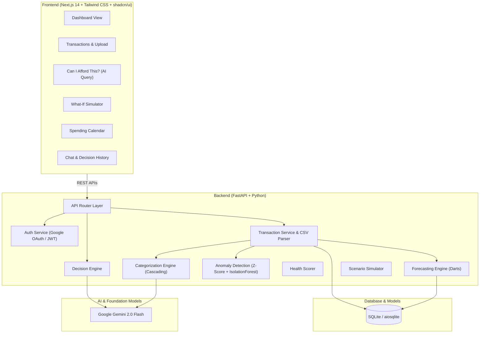

# 🏦 FinOps — AI-Powered Personal Financial Operating System

An intelligent web-based financial management platform that auto-categorizes bank transactions, forecasts future cash flow, detects recurring commitments & spending anomalies, and provides conversational "Can I Afford This?" decision intelligence powered by Google Gemini.

---

## 🌟 Key Features

- **Automated CSV Ingestion & Parsing**: Flexible parser accommodating Indian bank CSV exports (HDFC, SBI, ICICI, etc.).
- **3-Tier Categorization Pipeline**: Rule-based regex keyword matching + ML classifier (TF-IDF + LinearSVC) + Gemini LLM fallback.
- **Time-Series Cash Flow Forecasting**: Probabilistic forecasting with uncertainty confidence intervals using Darts (ExponentialSmoothing / Theta models).
- **Multi-layered Anomaly Detection**: Statistical Z-Score per category + scikit-learn IsolationForest for multi-dimensional anomaly detection.
- **Recurring Commitment Identification**: Automatic recognition of subscriptions, EMIs, and recurring bills with frequency clustering.
- **Financial Health Score**: Comprehensive 0–100 index evaluated across savings rate, expense consistency, debt-to-income, emergency buffer, and spending diversity.
- **Conversational Decision Simulator ("Can I Afford This?")**: Multi-modal affordability evaluator with cash-flow projection, risk breakdown, and alternative recommendations.
- **What-If Scenario Simulation**: Dynamic modeling for loans, large purchases, and savings goals.
- **Backtesting & Accuracy Evaluation**: "Financial Time Machine" to validate prediction accuracy against historical spending.

---

## 🏗️ System Architecture



---

## 📁 Repository Structure

```
bb26_ps22/
├── frontend/                       # Next.js 14 App Router frontend
│   ├── src/
│   │   ├── app/                    # Pages, layouts, routing
│   │   │   ├── api/auth/[...nextauth]/route.ts # NextAuth Google OAuth
│   │   │   ├── calendar/page.tsx   # Spending calendar view
│   │   │   ├── dashboard/page.tsx  # Executive overview dashboard
│   │   │   ├── history/page.tsx    # Decision & query history
│   │   │   ├── query/page.tsx      # "Can I Afford This?" interface
│   │   │   ├── simulator/page.tsx  # Scenario & loan simulator
│   │   │   ├── transactions/page.tsx # Transaction table & CSV upload
│   │   │   ├── layout.tsx          # Root theme & provider layout
│   │   │   └── page.tsx            # Landing & authentication entry
│   │   ├── components/
│   │   │   ├── common/             # Reusable badges, currency formatters
│   │   │   ├── dashboard/          # Metric cards, charts, alerts
│   │   │   ├── layout/             # Sidebar, Header, Dashboard shell
│   │   │   ├── query/              # Query form, response cards, meter
│   │   │   ├── simulator/          # Sliders, charts, loan forms
│   │   │   ├── transactions/       # Table, upload dropzone, badges
│   │   │   └── ui/                 # shadcn/ui primitives
│   │   ├── lib/                    # API client, auth, zustand store, utils
│   │   └── types/                  # Shared TypeScript interfaces
│   ├── public/                     # Static assets
│   ├── package.json
│   ├── tailwind.config.ts          # Dark fintech theme
│   └── tsconfig.json
│
├── backend/                        # FastAPI Python backend
│   ├── app/
│   │   ├── models/                 # SQLAlchemy ORM models
│   │   ├── routers/                # API endpoint controllers
│   │   ├── schemas/                # Pydantic validation schemas
│   │   ├── services/               # Core business & ML engines
│   │   ├── utils/                  # Utility & formatting helpers
│   │   ├── config.py               # Environment & app configuration
│   │   ├── database.py             # Async SQLite session management
│   │   └── main.py                 # FastAPI application factory
│   ├── alembic/                    # Database migrations
│   ├── alembic.ini
│   ├── requirements.txt            # Python dependencies
│   ├── render.yaml                 # Deployment spec
│   └── .env.example
│
├── scripts/                        # Utility & data generation scripts
│   ├── generate_test_data.py       # Multi-persona synthetic CSV generator
│   └── seed_db.py                  # Database populator
│
├── data/                           # Synthetic data directory
├── docker-compose.yml              # Multi-container orchestration
├── hackathon-plan.md               # Detailed technical specification
└── README.md
```

---

## 🚀 Getting Started

### Prerequisites
- **Node.js**: v18.x or later (v20+ recommended)
- **Python**: 3.10+ (3.11/3.12 recommended)
- **Git**

---

### Backend Setup

1. **Navigate to the backend directory**:
   ```bash
   cd backend
   ```

2. **Create and activate a virtual environment**:
   ```bash
   python3 -m venv venv
   source venv/bin/activate  # On Windows: venv\Scripts\activate
   ```

3. **Install dependencies**:
   ```bash
   pip install -r requirements.txt
   ```

4. **Configure environment variables**:
   ```bash
   cp .env.example .env
   ```
   Edit `.env` and fill in:
   - `GEMINI_API_KEY`: Obtain from [Google AI Studio](https://aistudio.google.com/apikey)
   - `GOOGLE_CLIENT_ID`: Google OAuth 2.0 Client ID
   - `JWT_SECRET_KEY`: Secure random string for session tokens

5. **Run database migrations (or initial schema create)**:
   ```bash
   alembic upgrade head
   ```

6. **Start the FastAPI development server**:
   ```bash
   uvicorn app.main:app --reload --port 8000
   ```
   API interactive docs will be available at: [http://localhost:8000/docs](http://localhost:8000/docs)

---

### Frontend Setup

1. **Navigate to the frontend directory**:
   ```bash
   cd frontend
   ```

2. **Install dependencies**:
   ```bash
   npm install
   ```

3. **Configure environment variables**:
   ```bash
   cp .env.local.example .env.local
   ```
   Set up your Google OAuth credentials and backend API URL:
   - `NEXT_PUBLIC_API_URL=http://localhost:8000`
   - `NEXTAUTH_URL=http://localhost:3000`
   - `NEXTAUTH_SECRET=your_secret_here`
   - `GOOGLE_CLIENT_ID=your_google_client_id`
   - `GOOGLE_CLIENT_SECRET=your_google_client_secret`

4. **Start the Next.js dev server**:
   ```bash
   npm run dev
   ```
   The application will be live at [http://localhost:3000](http://localhost:3000).

---

### Test Data Generation

Generate synthetic Indian financial transaction profiles (Salaried, Freelancer, Student):

```bash
# Generate all 3 persona datasets
python scripts/generate_test_data.py --persona all --months 12 --output-dir ./data/

# Or generate a single persona
python scripts/generate_test_data.py --persona salaried --months 12
```

To seed the database with generated test data:
```bash
python scripts/seed_db.py --file data/salaried_transactions.csv
```

---

## 👥 Collaboration & Module Ownership

Team members can work independently on their respective domains using the agreed API contracts defined in `hackathon-plan.md` (Section 6):

### 1. Backend Core & APIs
- **CSV Parsing & Ingestion**: `backend/app/services/csv_parser.py`, `backend/app/routers/transactions.py`
- **Database Models & Alembic**: `backend/app/models/`, `backend/alembic/`
- **Authentication**: `backend/app/routers/auth.py`

### 2. AI & Analytics Engines
- **Cascading Categorization**: `backend/app/services/categorizer.py`
- **Cash Flow Forecasting**: `backend/app/services/forecaster.py`
- **Anomaly & Recurring Detection**: `backend/app/services/anomaly_detector.py`, `backend/app/services/recurring_detector.py`
- **Health Scorer & Decision Engine**: `backend/app/services/health_scorer.py`, `backend/app/services/query_engine.py`, `backend/app/services/gemini_client.py`

### 3. Frontend Views & Visualizations
- **Dashboard & Cashflow Visualizations**: `frontend/src/app/dashboard/`, `frontend/src/components/dashboard/`
- **Transactions & Upload Experience**: `frontend/src/app/transactions/`, `frontend/src/components/transactions/`
- **"Can I Afford This?" & Simulator**: `frontend/src/app/query/`, `frontend/src/app/simulator/`
- **Calendar & Navigation Shell**: `frontend/src/app/calendar/`, `frontend/src/components/layout/`

---

## 📄 License & Blueprint Reference
For detailed endpoint contracts, database schemas, algorithm formulas, and prompt templates, refer to [hackathon-plan.md](hackathon-plan.md).
